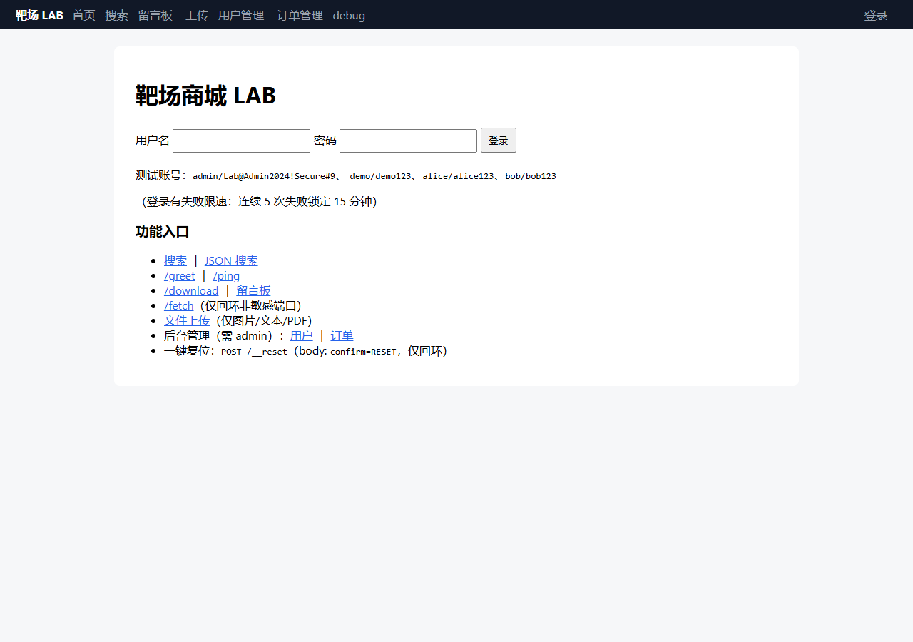

# WebVulnLab — 自研 Web 漏洞靶场

**EN** — A zero-dependency, single-file vulnerable web lab with 15+ real exploitable bugs. Runs with `python app.py`, binds 127.0.0.1 only, resets in one command. Built for practising and for testing scanners.

> 一个用 Python 标准库写成的、**故意充满真实可利用漏洞**的 Web 靶场。
> 零依赖、单文件、一键启动，专为安全学习者与自动化挖掘工具测试而设计。


---

## 为什么需要这个靶场？

市面上的靶场（DVWA、bWAPP、Vulhub）要么需要 LAMP 环境，要么需要 Docker，要么漏洞太旧。
WebVulnLab 的设计目标是：

- **零依赖**：只用 Python 标准库，`python app.py` 直接跑
- **单文件**：所有漏洞在一个 `app.py` 里，方便读源码学原理
- **真实可利用**：不是模拟漏洞，是真的能打进去的
- **可重置**：一键恢复干净状态，方便反复练习
- **安全沙箱**：只监听 `127.0.0.1`，SSRF 出站也被限制，不会误伤
- **双版本对照**：包含原版和加固版，学习"漏洞长什么样"和"怎么修"

---

## 一分钟上手

```bash
# 启动靶场（默认端口 8095）
python app.py

# 换端口
python app.py 9001

# 一键重置（删库重建 + 清空上传目录）
python app.py --reset
# 或 HTTP 方式（仅回环来源 + POST + confirm=RESET）
curl -X POST "http://127.0.0.1:8095/__reset?confirm=RESET"
```

Windows 用户可以直接双击 `run.cmd`（或 `run.cmd 9001` 指定端口）。

启动后打开浏览器访问 `http://127.0.0.1:8095`，首页有全部入口链接。
首次启动自动建库、写种子数据、生成 `config.bak` 与 `uploads/`。

---

## 演示



练习路径（手工挖 / 自动化工具实战 / 盲挖去提示化）见 [docs/PRACTICE.md](docs/PRACTICE.md)。

---

## 种子账号

> ⚠️ 以下口令**仅用于本机靶场**，不要在任何其他系统复用。

| 用户名 | 密码 | 角色 | 余额（分） |
|---|---|---|---|
| admin | `Lab@Admin2024!Secure#9` | admin | 100000 |
| demo | demo123 | user | 50000 |
| alice | alice123 | user | 88800 |
| bob | bob123 | user | 100 |

优惠券：`WELCOME10`（面值 1000 分，可无限领取）。

---

## 漏洞清单（15+ 类）

完整清单与逐条验证思路见 **[docs/BASELINE.md](docs/BASELINE.md)（靶场基线记录）**（练习时建议先别看，打完再对照）。

| 类别 | 漏洞 | 位置 |
|---|---|---|
| 认证 | 弱口令 / 明文存储 | 登录接口 |
| 认证 | 会话固定 / 可预测 token | sessions 表 |
| 授权 | 越权访问（IDOR） | `/api/orders/{id}` |
| 授权 | 业务接口漏接 CSRF | `/api/*` |
| 注入 | SQL 注入 | `/api/search` |
| 注入 | 命令注入 | `/api/ping` |
| 注入 | SSTI 模板注入 | `/render` |
| 注入 | XXE | `/api/import` |
| 文件 | 任意文件读取 / 路径穿越 | `/download` |
| 文件 | 不安全上传 | `/upload` |
| 业务 | 支付金额篡改 | `/api/checkout` |
| 业务 | 优惠券并发竞态 | `/api/coupon/redeem` |
| 业务 | 密码重置逻辑缺陷 | `/api/password/reset` |
| 信息 | 调试端点信息泄露 | `/debug` |
| 信息 | 错误信息堆栈泄露 | 全站 |

---

## 与自动化工具配合

靶场的作用是给工具提供**可控、可重置、可反复打**的目标：

```bash
# 1) 启动靶场
python app.py 8095

# 2) 用任意爬虫 / 扫描器指向 http://127.0.0.1:8095

# 3) 每轮打完复位，回到干净状态
curl -X POST "http://127.0.0.1:8095/__reset?confirm=RESET"
```

---

## 安全声明

本靶场**故意包含漏洞**，仅供本地学习与授权测试：

- 只监听 `127.0.0.1`，请勿改绑 `0.0.0.0` 后暴露到公网
- 源码中的种子口令仅用于靶场，请勿复用
- 不要把本靶场部署到任何可被外部访问的环境

漏洞报告与安全边界请见 [SECURITY.md](SECURITY.md)。

## 许可

MIT — 见 [LICENSE](LICENSE)。
